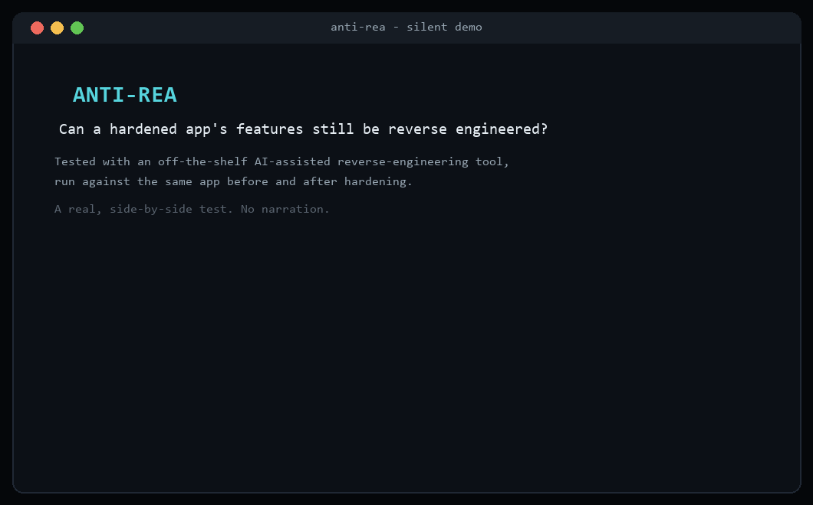
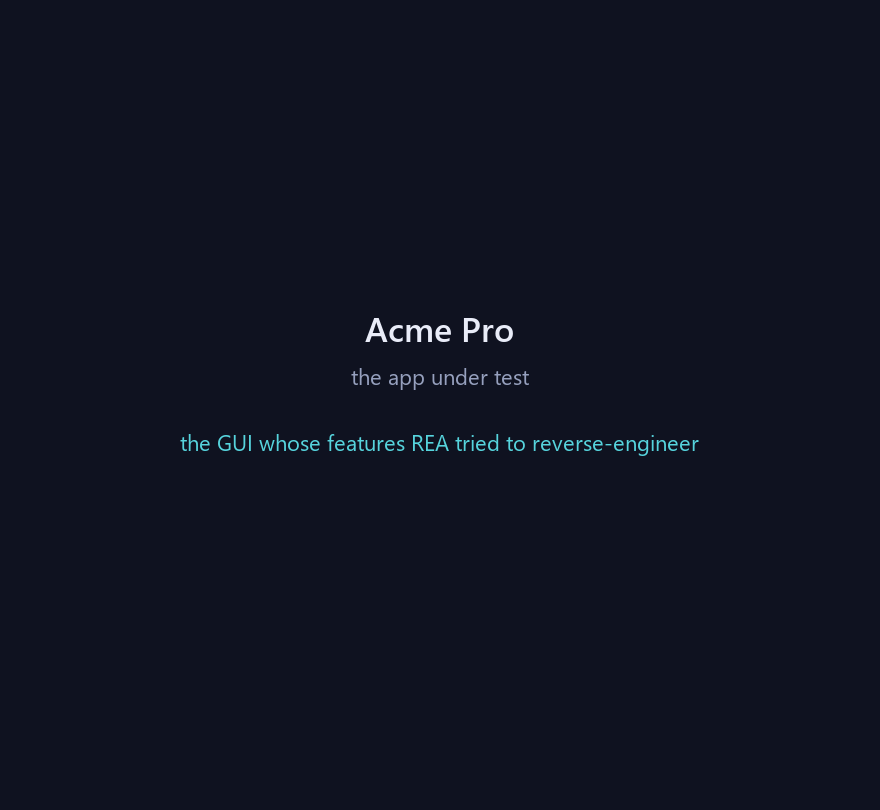

# Anti-REA

[](https://github.com/Ameya343/Anti-REA/actions/workflows/ci.yml)

***A**nti **R**everse-**E**ngineering & **A**nalysis — a threat-informed toolkit
for hardening your own apps against reverse engineering, including the
AI-assisted kind.*

Anti-REA measures how much your shipped code gives away to a reverse engineer,
strips the signals it can safely strip, and generates correct hardening configs
for the toolchains it can't run itself. It also ships as an **AI skill/plugin**
so an agent (e.g. Claude Code) can harden a project — including apps the AI just
generated — before you ship.

> ### The one thing to be honest about
> **No tool makes software impossible to reverse engineer.** Anything that runs
> on a device an attacker controls can eventually be analyzed. Anti-REA is about
> *defense-in-depth*: raising the cost, time, and skill required, and — most
> importantly — **keeping genuinely sensitive logic and secrets on a server the
> client cannot read.** If a decision must be trusted (licensing, entitlements,
> pricing), it belongs on the server. Client-side hardening protects your IP and
> slows analysis; it does not make the client trustworthy.

## Threat model

Reverse engineering is increasingly automated. A modern pipeline decompiles
native/Android/JS/Electron targets, recovers source from bundles and source
maps, observes runtime behavior, and then uses an LLM to reconstruct an app's
features from the signals it harvests — readable strings, descriptive
identifiers, comments, and the API/IPC surface. Anti-REA is built to deny
exactly those signals. See [THREAT_MODEL.md](THREAT_MODEL.md).

**It is stack-agnostic.** `antirea detect` auto-identifies which platform(s) a
project is — **web, Electron, Android, iOS, native (C/C++/Rust/Go), and
Python** — and the toolkit tailors its hardening and generated configs to
whatever it finds (a project is often several at once).

## Validated against a real analysis tool

A sample Electron app was hardened with Anti-REA, then analyzed **before and
after** with a real off-the-shelf AI-assisted reverse-engineering tool. It
recovered the endpoints, IPC channels, gating logic and source comments from the
original — and **none** of them from the hardened build, while its own count of
unresolved nodes rose 8×.



The app under test — a small Electron "Acme Pro" license/feature UI (silent):



Full methodology, data tables, and honest caveats: **[docs/validation.md](docs/validation.md)**.

## What it does

| Signal an analysis pipeline harvests | Anti-REA response |
|---|---|
| **Source maps** → full original source | strips `sourceMappingURL` refs, never copies `.map` files |
| **String literals** → "feature trace seeds" + LLM comprehension | encodes Python str/bytes literals to runtime-decoded form; configs for JS string-array obfuscation |
| **Comments / docstrings** → feature intent | removes them (Python via AST re-emit; JS via verified comment stripper) |
| **Descriptive identifiers** → feature reconstruction | safe Python local renaming (`--rename`, compile-verified); configs for terser mangling, R8/ProGuard, obfuscator |
| **API/IPC/route surface** → feature graph | reports every seed; guidance to move trusted logic server-side |
| **Native debug symbols** → readable pseudocode | strip/visibility/`-trimpath` flags, RASP guidance |
| **Traffic interception** → API behavior | TLS cert-pinning configs (Android NSC + OkHttp), Electron fuse hardening |

Hardening is **non-destructive** (writes a separate copy), **semantics-preserving**
(verified by tests), and **never auto-edits secrets** — those are flagged for you
to move server-side and rotate.

## Install

```bash
pip install -e .            # provides the `antirea` command
# or just run in place:
python -m antirea --help
```

Runtime has **no third-party dependencies** (standard library only), so the
hardener doesn't drag a large unaudited tree into your build. `node` is used, if
present, only to verify JS comment-stripping is safe.

### Optional: Rust acceleration

A small Rust core (`core/`) scans files in parallel and is used automatically
when built — scanning is ~4–5× faster on large trees, with **byte-for-byte
identical** results (enforced by `tests/test_rust_parity.py`). It's entirely
optional; without it the pure-Python scanner runs unchanged.

```bash
antirea install-core                                    # download a prebuilt binary (no Rust needed)
# or build from source:
cargo build --release --manifest-path core/Cargo.toml
```

Prebuilt binaries for Linux/macOS/Windows are published on each release; the
Python side downloads the right one into a per-user cache and uses it
automatically.

## Quickstart

```bash
# 1. Detect the stack (web, electron, android, ios, native, python)
python -m antirea detect ./my-app

# 2. Measure what you leak
python -m antirea scan ./my-app

# 3. See the before/after against a simulated analysis pass
python -m antirea test-rea ./my-app --keep

# 4. Write a hardened copy (source is never modified; dst must be outside src)
python -m antirea harden ./my-app ./my-app-hardened --rename

# 5. Emit ONLY the configs relevant to the detected stack
python -m antirea gen-config ./hardening-configs --for ./my-app
#   ...or force a set:  --platform android ios
```

`--rename` additionally mangles Python local variables that are provably safe to
rename (never parameters, closures, or anything reflective), each result
verified with `compile()` and reverted if it would break. Omit it for
literal-encoding + comment/docstring removal only.

## Result on the bundled sample

`examples/sample-app` is a deliberately leaky app (hardcoded secret, endpoints,
Electron IPC channels, a source map, descriptive names). `antirea test-rea`:

```
 reversibility :   80.6 -> 38.3
 resistance    :   19.4 -> 61.7     grade F -> C
 source-map files        1 -> 0
 hardcoded secrets       2 -> 0
 readable strings       30 -> 15
 comment density       13% -> 3%
```

The residual signal is honest and explained: JS identifiers still need terser/
obfuscator (configs provided), and an endpoint inside a Python f-string survives
(f-string parts aren't encoded) — which is exactly why endpoints and secrets
belong server-side, not just obfuscated.

## Use it as an AI skill / plugin

This repo is a Claude Code plugin (`.claude-plugin/plugin.json` +
`skills/anti-rea/`). Point your agent at it and ask it to "harden this app
against reverse engineering." The skill tells the agent to scan, triage secrets,
harden, generate platform configs, and prove the reduction — while stating the
honest limits and keeping trusted logic server-side.

- **Claude Code plugin:** add this directory as a plugin, or copy
  `skills/anti-rea/` into `.claude/skills/`.
- **Other agents:** the skill is a portable `SKILL.md` + `references/*.md` that
  drives the `antirea` CLI.

## Validate with your own tooling (optional)

`antirea test-rea` prints a ready-to-run command for analyzing the *hardened*
copy with an external analysis tool, so you can compare recovered evidence
before vs after. Anti-REA never runs third-party tooling for you.

## Develop

```bash
pip install -e ".[dev]"
pytest          # hardener + renamer correctness, signals, scoring, platforms, gate
flake8 antirea  # config in setup.cfg; lint on Python 3.12 (see CONTRIBUTING.md)
```

## Scope

Anti-REA is strictly defensive: it hardens software **you own or are authorized
to protect**. It does not reverse engineer, deobfuscate, or bypass protections
on anyone else's software.

## Acknowledgements

Anti-REA was validated against [REA](https://github.com/morluto/rea) (MIT,
© 2026 morluto), used only as an external tool — no REA code is included here.
See [NOTICE](NOTICE) for third-party tool attributions.

## License

MIT — see [LICENSE](LICENSE).
