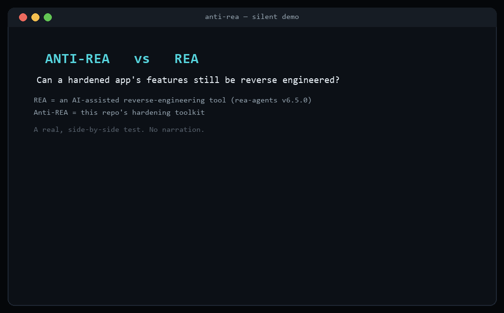
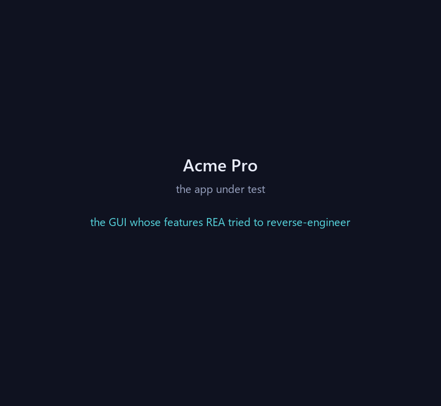

# Anti-REA

[](https://github.com/Ameya343/Anti-REA/actions/workflows/ci.yml)

**A threat-informed toolkit for hardening your own apps against reverse
engineering — including AI-assisted RE platforms like REA.**

Anti-REA measures how much your shipped code gives away to a reverse engineer,
strips the signals it can safely strip, and generates correct hardening configs
for the toolchains it can't run itself. It also ships as an **AI skill/plugin**
so an agent (e.g. Claude Code) can harden a project — including apps the AI just
generated — before you ship.

> ### The one thing to be honest about
> **No tool makes software impossible to reverse engineer.** Anything that runs
> on a device an attacker controls can eventually be analyzed. Anti-REA is about
> *defense-in-depth*: raising the cost, time, and skill required, and — most
> importantly — **keeping genuinely sensitive logic and secrets on a server the
> client cannot read.** If a decision must be trusted (licensing, entitlements,
> pricing), it belongs on the server. Client-side hardening protects your IP and
> slows analysis; it does not make the client trustworthy.

## Why "Anti-REA"

It is built against a concrete threat model: REA, an AI-assisted
reverse-engineering platform that decompiles native/Android/JS/Electron targets,
recovers source from bundles and source maps, observes runtime behavior, and
uses an LLM to reconstruct features from the signals it harvests. Anti-REA
targets exactly those signals. See [THREAT_MODEL.md](THREAT_MODEL.md).

**It is stack-agnostic.** `antirea detect` auto-identifies which platform(s) a
project is — **web, Electron, Android, iOS, native (C/C++/Rust/Go), and
Python** — and the toolkit tailors its hardening and generated configs to
whatever it finds (a project is often several at once).

## Proven against the real REA tool

A sample Electron app was hardened with Anti-REA, then the **actual REA
reverse-engineering tool** (`rea-agents` v6.5.0) was run against the original and
hardened builds. REA recovered the endpoints, IPC channels, gating logic and
source comments from the original — and **none** of them from the hardened
build, while its own count of unresolved nodes rose 8×.



The app under test — a small Electron "Acme Pro" license/feature UI (silent):



Full methodology, data tables, and honest caveats: **[docs/validation.md](docs/validation.md)**.

## What it does

| Signal REA harvests | Anti-REA response |
|---|---|
| **Source maps** → full original source | strips `sourceMappingURL` refs, never copies `.map` files |
| **String literals** → "feature trace seeds" + LLM comprehension | encodes Python str/bytes literals to runtime-decoded form; configs for JS string-array obfuscation |
| **Comments / docstrings** → feature intent | removes them (Python via AST re-emit; JS via verified comment stripper) |
| **Descriptive identifiers** → feature reconstruction | safe Python local renaming (`--rename`, compile-verified); configs for terser mangling, R8/ProGuard, obfuscator |
| **API/IPC/route surface** → feature graph | reports every seed; guidance to move trusted logic server-side |
| **Native debug symbols** → readable pseudocode | strip/visibility/`-trimpath` flags, RASP guidance |
| **Traffic interception** → API behavior | TLS cert-pinning configs (Android NSC + OkHttp), Electron fuse hardening |

Hardening is **non-destructive** (writes a separate copy), **semantics-preserving**
(verified by tests), and **never auto-edits secrets** — those are flagged for you
to move server-side and rotate.

## Install

```bash
pip install -e .            # provides the `antirea` command
# or just run in place:
python -m antirea --help
```

Runtime has **no third-party dependencies** (standard library only), so the
hardener doesn't drag a large unaudited tree into your build. `node` is used, if
present, only to verify JS comment-stripping is safe.

## Quickstart

```bash
# 1. Detect the stack (web, electron, android, ios, native, python)
python -m antirea detect ./my-app

# 2. Measure what you leak
python -m antirea scan ./my-app

# 3. See the before/after against a simulated REA pass
python -m antirea test-rea ./my-app --keep

# 4. Write a hardened copy (source is never modified; dst must be outside src)
python -m antirea harden ./my-app ./my-app-hardened --rename

# 5. Emit ONLY the configs relevant to the detected stack
python -m antirea gen-config ./hardening-configs --for ./my-app
#   ...or force a set:  --platform android ios
```

`--rename` additionally mangles Python local variables that are provably safe to
rename (never parameters, closures, or anything reflective), each result
verified with `compile()` and reverted if it would break. Omit it for
literal-encoding + comment/docstring removal only.

## Result on the bundled sample

`examples/sample-app` is a deliberately leaky app (hardcoded secret, endpoints,
Electron IPC channels, a source map, descriptive names). `antirea test-rea`:

```
 reversibility :   80.6 -> 38.3
 resistance    :   19.4 -> 61.7     grade F -> C
 source-map files        1 -> 0
 hardcoded secrets       2 -> 0
 readable strings       30 -> 15
 comment density       13% -> 3%
```

The residual signal is honest and explained: JS identifiers still need terser/
obfuscator (configs provided), and an endpoint inside a Python f-string survives
(f-string parts aren't encoded) — which is exactly why endpoints and secrets
belong server-side, not just obfuscated.

## Use it as an AI skill / plugin

This repo is a Claude Code plugin (`.claude-plugin/plugin.json` +
`skills/anti-rea/`). Point your agent at it and ask it to "harden this app
against reverse engineering." The skill tells the agent to scan, triage secrets,
harden, generate platform configs, and prove the reduction — while stating the
honest limits and keeping trusted logic server-side.

- **Claude Code plugin:** add this directory as a plugin, or copy
  `skills/anti-rea/` into `.claude/skills/`.
- **Other agents:** the skill is a portable `SKILL.md` + `references/*.md` that
  drives the `antirea` CLI.

## Validate against real REA (optional, your call)

`antirea test-rea` prints the exact REA CLI command to analyze the *hardened*
copy so you can compare REA's recovered evidence before vs after. Anti-REA does
**not** run REA for you.

## Develop

```bash
pip install -e ".[dev]"
pytest          # hardener + renamer correctness, signals, scoring, platforms, gate
flake8 antirea  # config in setup.cfg; lint on Python 3.12 (see CONTRIBUTING.md)
```

## Scope

Anti-REA is strictly defensive: it hardens software **you own or are authorized
to protect**. It does not reverse engineer, deobfuscate, or bypass protections
on anyone else's software.

## Acknowledgements

Anti-REA was validated against [REA](https://github.com/morluto/rea) (MIT,
© 2026 morluto), used only as an external tool — no REA code is included here.
See [NOTICE](NOTICE) for third-party tool attributions.

## License

MIT — see [LICENSE](LICENSE).
